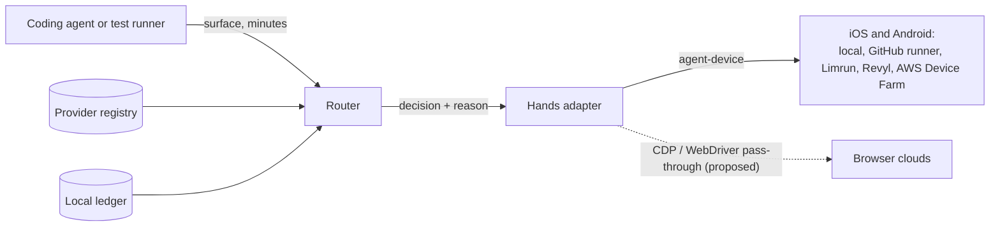

# OpenDeviceRouter

**Give coding agents eyes on real browsers, iOS simulators, and Android phones at $0.**

A coding agent in a Linux sandbox cannot boot an iOS Simulator, cannot open Safari, and has no phone to tap. Device and browser clouds can do all three, and many have a free allowance. OpenDeviceRouter is a session router that sits between your agent or test runner and the clouds you have connected. It sends each session to free capacity first, tells you what is left, and refuses to route when the free capacity is gone.

> **Pre-release.** The provider registry, the routing decision, the ledger, and a benchmark harness work today. Launching sessions for you does not. The table below is exact about which is which.

## What works today

| Piece | State | Try it |
| --- | --- | --- |
| Provider registry: 19 entries with signup steps, credential handoff, free allowance, limits, and terms notes, each with a source URL and check date | Works | `npm run odr -- providers` |
| Validator for those entries (JSON Schema plus policy rules) | Works, runs in CI | `npm run validate` |
| [Free-tier index](docs/free-tiers.md), generated from the registry | Works. Vendor-documented, not measured | `npm run docs:free-tiers` |
| Guided connect: prints what a provider's signup needs and how to get a credential | Works. You do the signup | `npm run odr -- connect revyl` |
| Ledger of connected providers and estimated free capacity left | Works. Debits are manual | `npm run odr -- status` |
| Routing decision with a reason for every candidate | Works as a dry run | `npm run odr -- plan --surface ios-simulator --minutes 10` |
| Commands to drive the chosen device with [agent-device](https://github.com/callstack/agent-device) | Printed, not executed | same as above |
| Cold-boot benchmark on GitHub-hosted runners | Works. First results committed by CI on 2026-11-22: [bench/RESULTS.md](bench/RESULTS.md). Small sample; read the limits in the method page | Actions tab, `bench-github-runners` |
| `odr run`, `odr mcp`, `odr proxy`, SDKs, npm package | Not built | [ROADMAP.md](ROADMAP.md) |
| Benchmarks of device clouds | Not run | [bench/METHODOLOGY.md](bench/METHODOLOGY.md) |

## Quick start

Needs Node.js 20.19 or newer.

```sh
git clone https://github.com/QA-army/opendevicerouter.git
cd opendevicerouter
npm install

npm run odr -- providers                 # what is in the registry
npm run odr -- connect local --done      # your own machine counts as a provider
npm run odr -- connect revyl             # checklist for a cloud provider; you sign up yourself
npm run odr -- plan --surface ios-simulator --minutes 10
```

`plan` prints which provider would be used, why the others were skipped, and the `agent-device` commands to drive the session. Nothing is started and nothing is debited. After a session, record it:

```sh
npm run odr -- record revyl --surface ios-simulator --minutes 8
npm run odr -- status
```

To get an `odr` command on your path: `npm run build && npm link`.

## How it works



The router decides **where** a session runs. Your agent or test suite decides **what to tap**. The taps themselves go through [agent-device](https://github.com/callstack/agent-device) for mobile, and through unmodified CDP or WebDriver for browsers. OpenDeviceRouter does not reimplement device control.

### Three stages

| Stage | The router decides from | State |
| --- | --- | --- |
| **1. Deterministic switch and ledger** (v0.1) | Registry facts, your connections, your ledger. Fixed order: own hardware, public-repo runners, daily, monthly, open-source program, one-time trial. Refuses when nothing free fits | Decision logic built. Session launch not built |
| **2. Telemetry router** (v0.2) | Stage 1, plus measured boot time, queue time, failed boots, and session survival. Retries elsewhere on infrastructure faults | Proposed |
| **3. Intent router** (v1.0) | Stage 2, plus a git diff or agent goal and a budget. Proposes the smallest set of targets that covers the change | Proposed |

Spend limits, quotas, session caps, and capability checks are deterministic in every stage. A model may propose targets in stage 3. It never overrides a limit.

Details: [docs/architecture.md](docs/architecture.md).

## First targets

The first routed targets are four places a mobile session can run, plus your own machine as the baseline.

| Target | Surfaces | Free allowance (vendor-documented, 2026-11-22) | Control path |
| --- | --- | --- | --- |
| Local devices | iOS Simulator, Android emulator, USB devices | Your hardware | agent-device |
| GitHub-hosted runners | iOS Simulator, Android emulator | Standard runners are free on public repositories ([GitHub docs](https://docs.github.com/en/actions/concepts/billing-and-usage)) | agent-device on the runner |
| Limrun | iOS Simulator, Android emulator | 120 one-time credits ([pricing](https://limrun.com/pricing)) | [agent-device provider](https://agent-device.dev/docs/limrun) |
| Revyl | iOS Simulator, Android emulator | Up to 1,200 device minutes a month ([pricing](https://revyl.com/pricing/)) | [agent-device plugin](https://agent-device.dev/docs/revyl) |
| AWS Device Farm | Real Android and iOS devices | 1,000 one-time device minutes ([FAQ](https://aws.amazon.com/device-farm/faqs/)) | [agent-device provider](https://agent-device.dev/docs/aws-device-farm) |

Fourteen more providers are in the registry as researched or candidate entries, including browser session clouds. See [docs/free-tiers.md](docs/free-tiers.md). Free tiers change without notice; each row links the page it came from.

## Benchmark

A public, re-runnable benchmark of how long a device takes to be ready and how often it fails. Raw result files are committed, the summary page is generated from them, and CI fails if the two disagree.

- Results: [bench/RESULTS.md](bench/RESULTS.md)
- Method and publishing rules: [bench/METHODOLOGY.md](bench/METHODOLOGY.md)

Today it covers iOS Simulator and Android emulator cold boot on GitHub-hosted runners only. Device clouds are added once the project has its own account on each and the provider's terms have been read.

## Your accounts, your limits

- You sign up with each provider yourself. One account per provider per organization.
- `odr` does not create accounts, accept terms, solve captchas, or enter phone or card details.
- `odr` does not store credentials. It checks that an environment variable is set and never reads its value.
- There is no paid path in the code. The ledger is a local estimate, and the provider's own meter is the authority, so turn on a provider-side spend cap where one exists.

Full rules: [docs/account-policy.md](docs/account-policy.md).

## What this is not

- Not a device host. Sessions run on your machine or on clouds you have an account with.
- Not a test framework. It does not decide what to test or whether a result is a bug.
- Not a way to pool, share, or rotate free trials.

## Contributing

The most useful contribution is a correction to a provider entry, with a link to the vendor page. See [CONTRIBUTING.md](CONTRIBUTING.md). Coding agents working in this repository: read [AGENTS.md](AGENTS.md).

## License and affiliation

MIT. See [LICENSE](LICENSE).

Maintained by [QA.army](https://www.qa.army). OpenDeviceRouter decides where a session runs. Deciding which journeys to test and turning evidence into findings is QA.army's product and is not in this repository.

This project is not affiliated with, sponsored by, or endorsed by any provider or tool named here. Product names are used only to identify the services described.
