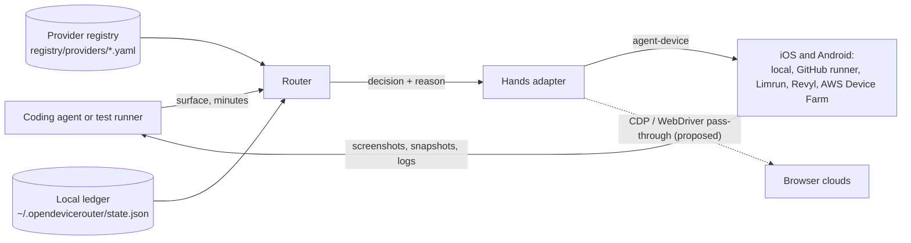

# Architecture

Status words used here: **built** means the code is in this repository and covered by tests. **Proposed** means designed and not built.

## The problem

A coding agent in a Linux sandbox cannot boot an iOS Simulator, cannot open Safari, and has no phone. Device and browser clouds solve that, and many have free allowances. Each has its own signup, credential, quota, session limit, and control protocol. A team that wants to stay inside the free allowances has to track all of that by hand.

OpenDeviceRouter sits between the caller and the clouds the caller has connected. It answers one question: **where should this session run?** It then hands the caller a way to drive the session.

## Components

| Component | What it does | Status |
| --- | --- | --- |
| Provider registry | One YAML file per provider: surfaces, control path, signup steps, credential handoff, free allowances, terms notes. Every fact has a source URL and a check date | Built |
| Validator | JSON Schema plus policy rules, run in CI | Built |
| Ledger | Records which providers are connected and what was used. Stores no credentials | Built (manual debit) |
| Router | Picks an allowance for a request, or refuses | Built (stage 1 logic) |
| Hands adapter | Turns a decision into an `agent-device` invocation | Built (prints commands; does not launch) |
| Session launcher (`odr run`) | Starts the session and debits the ledger automatically | Proposed |
| Agent surface (`odr mcp`) | Lets an agent ask for a route and read the ledger | Proposed |
| Pass-through proxy (`odr proxy`) | One endpoint for existing Playwright or Appium suites | Proposed |
| Benchmark | Public cold-boot and reliability numbers | Built for GitHub-hosted runners only |

## Three stages

The router grows in three stages. Each stage adds an input. None of them removes the hard limits.

### Stage 1: deterministic switch and ledger (v0.1)

Inputs: the registry, your connections, the ledger.

For a request `{surface, minutes, parallel}` every allowance of every provider is checked in this order. The first failed check is recorded as the reason it was skipped.

1. The provider is connected.
2. The provider offers the surface, and the surface is available on this connection.
3. There is a verified control path that covers the surface.
4. The allowance covers the surface, is not manual-only, and its renewal is documented.
5. An open-source program allowance is used only after you confirm you were accepted.
6. The allowance can be metered in minutes. Credit and dollar allowances need a documented per-minute rate.
7. The session fits the provider's session-length and concurrency caps.
8. The allowance has not expired and has enough left.

Eligible allowances are ordered: your own hardware, public-repository runners, daily, monthly, open-source program, one-time trial. Capacity that renews is spent before capacity that does not. Ties go to the allowance with the most left, then by provider id.

If nothing is eligible the router refuses. There is no paid path in the code.

Same inputs give the same decision, and `odr plan` prints every candidate with the reason it was chosen or skipped.

### Stage 2: telemetry router (v0.2, proposed)

Adds measurements: boot time, queue time, failed boots, and session survival, from your own runs and from the public benchmark. Among allowances that pass every stage 1 check, the router prefers the one likely to be ready soonest and to stay up. It can retry on another provider when a failure is an infrastructure fault, not a test failure.

### Stage 3: intent router (v1.0, proposed)

Adds intent: a git diff or an agent's goal, plus a budget. The router proposes the smallest set of targets that covers the change. A CSS change to a web view does not need a real-device matrix. A change to a native camera permission does. This is the only stage where a model may be involved, and it only proposes. Everything it proposes still passes through the stage 1 checks.

### Never decided by a model

Spend limits, quotas, session caps, capability checks, and which accounts exist. These stay deterministic in every stage.

## Who drives the device

OpenDeviceRouter does not implement taps, swipes, typing, or snapshots.

- **Mobile:** [agent-device](https://github.com/callstack/agent-device) (MIT) is the control layer. It drives local simulators, emulators, and USB devices, and connects to BrowserStack, AWS Device Farm, TestMu AI, Limrun, and Revyl through `agent-device connect <provider>` ([agent-device device clouds](https://agent-device.dev/docs/device-clouds), read 2026-11-22). It has a CLI, an MCP server, and a Node.js client. odr runs it in-process through its Node API (`startAgentDevice`) from `src/session/drivers/agent-device.ts`. Appetize is driven through `@appetize/cli` from `src/session/drivers/appetize.ts`. Both drivers map the session interface (screenshot, tap, type, swipe, key, install, launch, release) onto those tools and verify closure; neither implements input or capture itself.
- **Web (proposed):** existing clients keep speaking CDP or WebDriver. The proxy forwards the connection to the chosen provider and does not reinterpret commands.

The caller, whether an agent or a test suite, decides what to tap. The router decides where.

`agent-device` is an optional peer dependency and needs Node.js 22.12 or newer. `odr` itself runs on Node.js 20.19 or newer.

## Ledger

`~/.opendevicerouter/state.json`, or `$ODR_HOME/state.json`. It holds connection dates and usage events. File mode is `0600`.

- Daily allowances reset at 00:00 UTC. Monthly allowances reset on the first of the month, UTC. A provider's real billing cycle may differ.
- One-time allowances count from the connection date and lapse after `expires_days` when the vendor documents an expiry.
- Usage is recorded with `odr record`. Until `odr run` exists, a session you forget to record is not counted.
- The ledger is an estimate. The provider's meter is the authority.

## What this project does not do

- It does not decide which user journeys to test or whether a result is a bug.
- It does not create accounts or hold shared credentials. See [account-policy.md](account-policy.md).
- It does not host devices.
- It does not resell provider capacity.

## Relationship to QA.army

OpenDeviceRouter is maintained by QA.army and is MIT licensed. It decides where a session runs and returns what the session produced. Deciding which journeys to run and turning evidence into findings is QA.army's product and is outside this repository.
